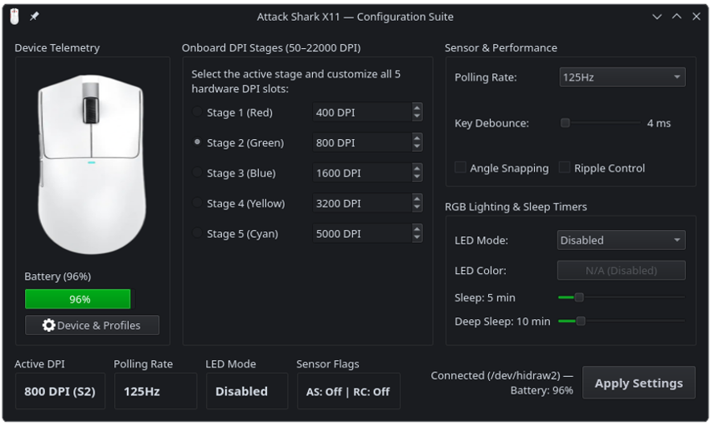

    
## Attack Shark X11 for Linux

This software provides configuration support for the [Attack Shark X11](https://attackshark.com/products/attack-shark-x11-wireless-gaming-mouse-charging-dock), allowing users to adjust settings such as polling rate and lighting modes on Linux. It serves as an unofficial alternative to the Windows software and is actively being developed to expand feature support.

## Disclaimer
This is an independent, community-driven project, not affiliated with or endorsed by Attack Shark, Guangzhou Shijunxingcheng Electronics Technology Co., Ltd., or PixArt Imaging Inc. No original driver source code is used; all communication protocols were independently reverse engineered. All trademarks and product names belong to their respective owners and are used for identification purposes only.

## Install

**Build it yourself (Recommended):**
```sh
git clone https://github.com/iago-fragnan/attack-shark-x11-linux.git
# Install dependencies
# cmake build-essential pkg-config libudev-dev libusb-1.0-0-dev qt6-base-dev
cd attack-shark-x11-linux
cmake -B build -DCMAKE_BUILD_TYPE=Release
cmake --build build -j$(nproc)
./build/attackshark-x11
```

**Arch Linux (AUR):**
```sh
paru -S attackshark-x11 # you can also use yay
```

**Debian/Ubuntu:**
```sh
# Install dependencies
sudo apt-get install -y wget git cmake build-essential pkg-config libudev-dev libusb-1.0-0-dev qt6-base-dev
sudo dpkg -i attackshark-x11.deb # .deb file from releases
```


## Documentation

Detailed technical documentation and reverse engineering reports are available in the [`docs/`](docs/) directory:
- [Reverse Engineering Report](docs/REVERSE_ENGINEERING.md): Comprehensive analysis of the official Windows driver (`AttackShark.exe` / `hiddriver_3.dll`), assembly disassembly snippets, hardware ACK packets, battery ADC steps, and physical button sync.
- [HID Protocol Reference](docs/PROTOCOL.md): Low-level 64-byte Feature Report layouts, 16-bit Big-Endian checksum calculations, PAW3311 step tables, and asynchronous Input Reports.

## TODO

- [x] Polling Rate
- [x] DPI Configuration
- [x] LED Color Control
- [x] Apply User-Selected Settings
- [x] Battery Percentage Monitoring
- [x] Display Current Applied Settings on Startup
- [x] Battery Charging Indicator
- [x] Power Management & Standby Control
- [x] Key Response Time
- [x] Ripple Control
- [x] Angle Snapping
- [x] Automatic Device Selection
- [x] Custom window for settings
    - [ ] Macro Support
    - [ ] Minimize to System Tray
    - [x] Profiles
        - [x] Apply
        - [ ] Save
        - [ ] Load
    - [x] Device selection
    - [ ] Auto Startup
- [ ] Low Battery Notification


## Acknowledgements

- Lightning and Settings icons provided by [Flaticon](https://www.flaticon.com/).
- Additional Reverse engineering references from [HarukaYamamoto0](https://github.com/HarukaYamamoto0/attack-shark-x11-driver/).
- Contributors.
- You, for reading this.
